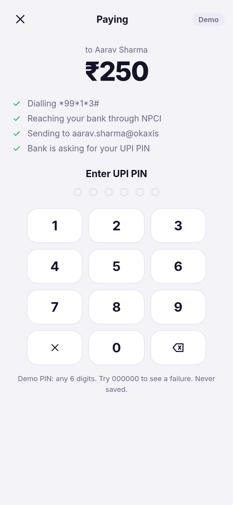
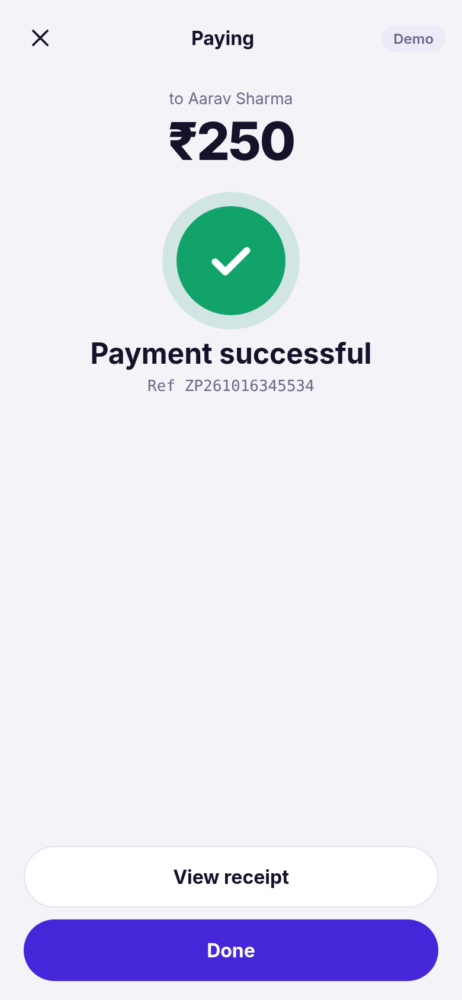
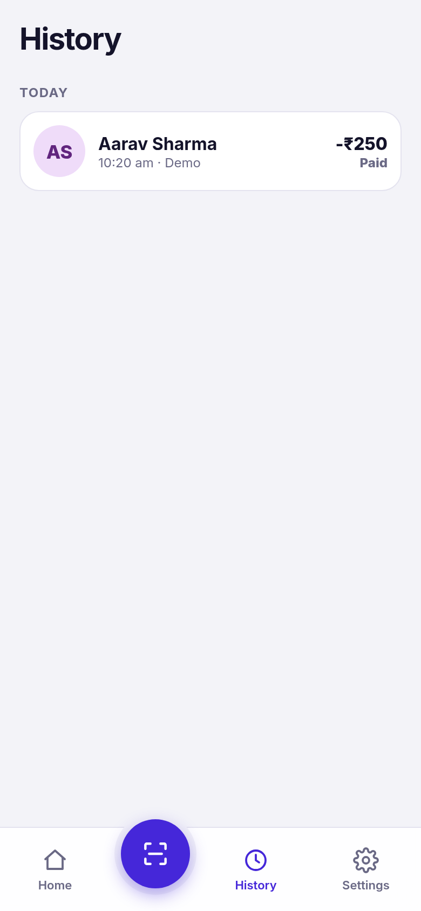
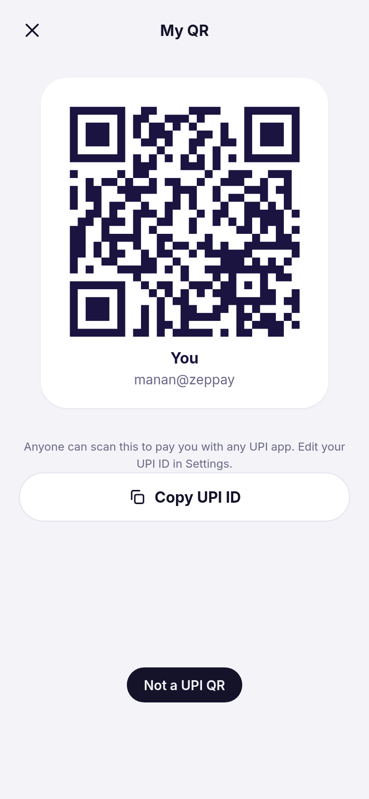
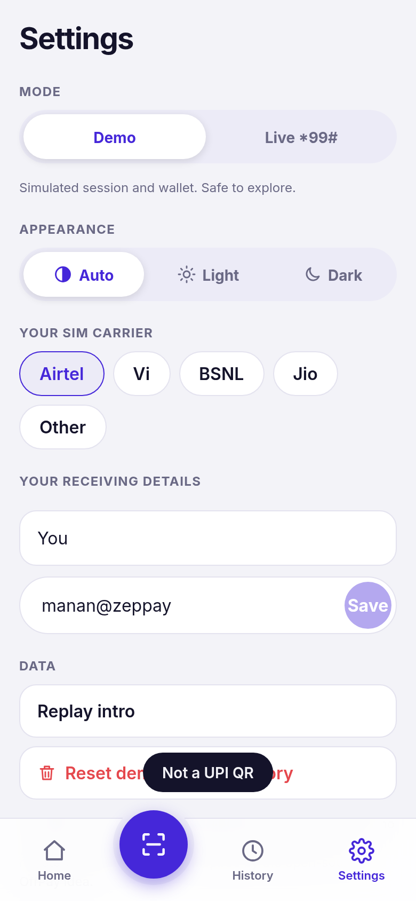
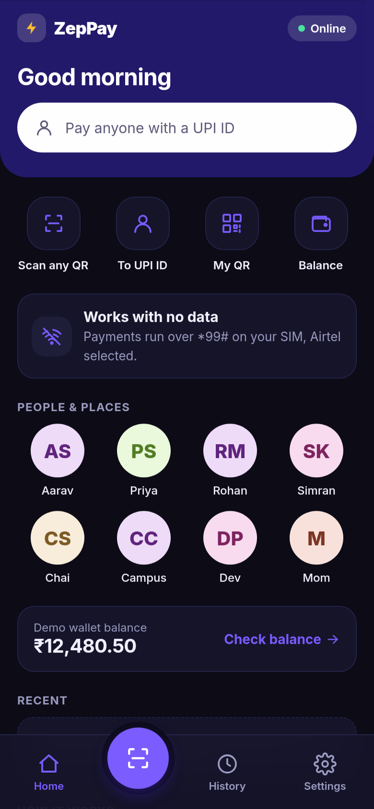

# ZepPay

Offline UPI payments over `*99#`. An installable PWA with a built-in demo mode, so you can try the whole flow without touching a bank.

**Live app:** https://mananbharti.github.io/zeppay-pwa/

<p align="center">
  
  
  
  
</p>
<p align="center">
  
  
  
  
</p>

## What it does

- **Scan any UPI QR** with the camera, or upload a QR image, or paste a UPI ID / `upi://` link
- **Pay flow** with payee check, amount limits (Rs 1 to Rs 5,000, the `*99#` cap) and a confirm step
- **Demo mode** (default): simulated `*99#` session, UPI PIN pad, demo wallet, success and failure paths. Nothing touches a bank
- **Live mode**: copies the UPI ID and opens your dialer with `*99*1*3#` (pay) or `*99*3#` (balance). Your bank handles the real payment
- **My QR** to receive money, receipts, history grouped by day (last 200, on-device only)
- **Auto / Light / Dark** appearance, carrier picker (Jio doesn't support `*99#` and live payments are blocked for it)
- Works fully offline once loaded, installs to the home screen

## Privacy

Everything stays in `localStorage` on your device. The UPI PIN is held in memory only for the length of a session and never saved. No analytics, no accounts, no servers.

## Run it

```bash
npm install
npm run dev        # http://localhost:5173
npm run build && npm run preview
```

## Tests

```bash
npm test           # unit tests (UPI parsing, validation, formatting)
npm run build && npm run e2e   # 44 browser checks in headless Chrome
```

The e2e suite covers onboarding, the full pay flow, wrong-PIN failure, balance, QR decode from an image, My QR, theme switching, Jio blocking, live-mode handoff, service worker and offline load. Set `CHROME=/path/to/chrome` if Chrome isn't at `/usr/bin/google-chrome`, and `SHOTS=1` to regenerate the screenshots.

## Stack

React 19, Vite, jsQR, qrcode, hand-written service worker. No UI kit.

## Notes

Independent side project, not a registered payment service. UPI is a trademark of NPCI. The idea of a friendlier front end for `*99#` is shared with the open-source [OffPay](https://github.com/laksh-ya/OffPayApp); ZepPay is a separate codebase and design.

MIT License.
